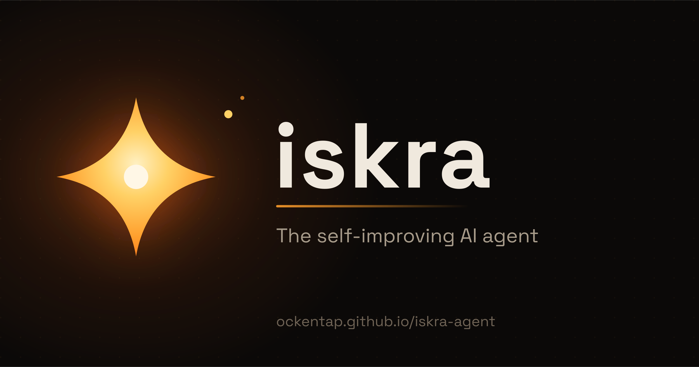

<p align="center">
  
</p>

# Iskra ✦

<p align="center">
  <a href="https://ockentap.github.io/iskra-agent/docs/"></a>
  <a href="https://github.com/ockentap/iskra-agent/blob/iskra-rebrand/LICENSE"></a>
  <a href="https://github.com/ockentap/iskra-agent"></a>
</p>

**A self-improving AI agent that lives on your own infrastructure.** Iskra creates skills from
experience, improves them during use, nudges itself to persist knowledge, searches its own past
conversations, and builds a deepening model of who you are across sessions. Run it on a $5 VPS, a
GPU cluster, or serverless infrastructure that costs nearly nothing when idle. It is not tied to
your laptop — talk to it from Telegram while it works away on its own.

Use any model you want — OpenRouter, OpenAI, Anthropic, a local endpoint, and
[many others](https://ockentap.github.io/iskra-agent/docs/integrations/providers). Switch with
`iskra model` — no code changes, no lock-in.

> Iskra is an independent fork of [Hermes Agent](https://github.com/NousResearch/hermes-agent) by
> Nous Research, released under the MIT license. It keeps the full agent engine and adds its own
> identity, docs, and tooling. See [FORK.md](FORK.md) for exactly what the fork changes.

<table>
<tr><td><b>A real terminal interface</b></td><td>Full TUI with multiline editing, slash-command autocomplete, conversation history, interrupt-and-redirect, and streaming tool output.</td></tr>
<tr><td><b>Lives where you do</b></td><td>Telegram, Discord, Slack, WhatsApp, Signal, and CLI — all from a single gateway process. Voice memo transcription, cross-platform conversation continuity.</td></tr>
<tr><td><b>A closed learning loop</b></td><td>Agent-curated memory with periodic nudges. Autonomous skill creation after complex tasks. Skills self-improve during use. FTS5 session search with LLM summarization for cross-session recall. Compatible with the <a href="https://agentskills.io">agentskills.io</a> open standard.</td></tr>
<tr><td><b>Scheduled automations</b></td><td>Built-in cron scheduler with delivery to any platform, plus self-healing: a failed job is triaged and rectified automatically. Daily reports, nightly backups, weekly audits — in natural language, running unattended.</td></tr>
<tr><td><b>Delegates and parallelizes</b></td><td>Spawn isolated subagents for parallel workstreams. Write Python scripts that call tools via RPC, collapsing multi-step pipelines into zero-context-cost turns.</td></tr>
<tr><td><b>Runs anywhere, not just your laptop</b></td><td>Six built-in terminal backends — local, Docker, SSH, Modal, Daytona, and Vercel Sandbox — plus plugin backends such as Singularity/Apptainer. Daytona and Modal offer serverless persistence: the environment hibernates when idle and wakes on demand.</td></tr>
<tr><td><b>Proactive assistant state</b></td><td>A curated, character-limited goals / todos / reminders list kept in the system prompt and updated autonomously; time-bound reminders become one-off scheduled jobs that message you.</td></tr>
</table>

---

## Quick Install

### Linux, macOS, WSL2

```bash
curl -fsSL https://ockentap.github.io/iskra-agent/install.sh | bash
```

### Windows (native, PowerShell)

```powershell
iex (irm https://ockentap.github.io/iskra-agent/install.ps1)
```

Native Windows runs Iskra without WSL — CLI, gateway, TUI, and tools all work natively. If you'd
rather use WSL2, the Linux/macOS one-liner above works there too.

After installation:

```bash
source ~/.bashrc    # reload shell (or: source ~/.zshrc)
iskra               # start chatting!
```

### From source

```bash
git clone https://github.com/ockentap/iskra-agent.git ~/.iskra/iskra-agent
cd ~/.iskra/iskra-agent
uv sync --python 3.14
uv run iskra --version
```

See [installation methods](https://ockentap.github.io/iskra-agent/docs/getting-started/installation)
for the full set of options.

---

## Getting Started

```bash
iskra              # Interactive CLI — start a conversation
iskra model        # Choose your LLM provider and model
iskra tools        # Configure which tools are enabled
iskra config set   # Set individual config values
iskra config get   # Print individual config values
iskra gateway      # Start the messaging gateway (Telegram, Discord, etc.)
iskra setup        # Run the full setup wizard (configures everything at once)
iskra update       # Update to the latest version
iskra doctor       # Diagnose any issues
```

📖 **[Full documentation →](https://ockentap.github.io/iskra-agent/docs/)**

---

## CLI vs Messaging Quick Reference

Iskra has two entry points: start the terminal UI with `iskra`, or run the gateway and talk to it
from Telegram, Discord, Slack, WhatsApp, Signal, or Email. Once you're in a conversation, many
slash commands are shared across both interfaces.

| Action                         | CLI                          | Messaging platforms                                          |
| ------------------------------ | ---------------------------- | ------------------------------------------------------------ |
| Start chatting                 | `iskra`                      | Run `iskra gateway setup` + `iskra gateway start`, then message the bot |
| Start fresh conversation       | `/new` or `/reset`           | `/new` or `/reset`                                           |
| Change model                   | `/model [provider:model]`    | `/model [provider:model]`                                    |
| Set a personality              | `/personality [name]`        | `/personality [name]`                                        |
| Retry or undo the last turn    | `/retry`, `/undo`            | `/retry`, `/undo`                                            |
| Compress context / check usage | `/compress`, `/usage`        | `/compress`, `/usage`                                        |
| Browse skills                  | `/skills` or `/<skill-name>` | `/<skill-name>`                                              |
| Interrupt current work         | `Ctrl+C` or send a new message | `/stop` or send a new message                              |

For the full command lists, see the [CLI guide](https://ockentap.github.io/iskra-agent/docs/user-guide/cli)
and the [Messaging Gateway guide](https://ockentap.github.io/iskra-agent/docs/user-guide/messaging).

---

## Documentation

All documentation lives at **[ockentap.github.io/iskra-agent/docs](https://ockentap.github.io/iskra-agent/docs/)**:

| Section | What's Covered |
| ------- | -------------- |
| [Quickstart](https://ockentap.github.io/iskra-agent/docs/getting-started/quickstart) | Install → setup → first conversation in 2 minutes |
| [CLI Usage](https://ockentap.github.io/iskra-agent/docs/user-guide/cli) | Commands, keybindings, personalities, sessions |
| [Configuration](https://ockentap.github.io/iskra-agent/docs/user-guide/configuration) | Config file, providers, models, all options |
| [Messaging Gateway](https://ockentap.github.io/iskra-agent/docs/user-guide/messaging) | Telegram, Discord, Slack, WhatsApp, Signal |
| [Security](https://ockentap.github.io/iskra-agent/docs/user-guide/security) | Command approval, DM pairing, container isolation |
| [Tools & Toolsets](https://ockentap.github.io/iskra-agent/docs/user-guide/features/tools) | 40+ tools, toolset system, terminal backends |
| [Skills System](https://ockentap.github.io/iskra-agent/docs/user-guide/features/skills) | Procedural memory, Skills Hub, creating skills |
| [Memory](https://ockentap.github.io/iskra-agent/docs/user-guide/features/memory) | Persistent memory, user profiles, best practices |
| [MCP Integration](https://ockentap.github.io/iskra-agent/docs/user-guide/features/mcp) | Connect any MCP server for extended capabilities |
| [Cron Scheduling](https://ockentap.github.io/iskra-agent/docs/user-guide/features/cron) | Scheduled tasks with platform delivery and self-healing |
| [Architecture](https://ockentap.github.io/iskra-agent/docs/developer-guide/architecture) | Project structure, agent loop, key classes |

---

## The fork

Iskra tracks upstream Hermes Agent and re-applies its surface rebrand on every merge. The rename
is rule-driven: `scripts/iskra_rebrand.py --check` reports drift, `--apply` rewrites only what
upstream put back. To update:

```bash
python scripts/iskra_update.py --dry-run   # how far behind
python scripts/iskra_update.py             # fetch, merge, reapply rebrand, commit
```

Internals (`hermes_*` modules, `HERMES_*` env vars, config keys, DB schema) are deliberately kept
so upstream merges stay cheap. See [FORK.md](FORK.md) for the full surface map.

---

## Contributing

Contributions are welcome. See the
[Contributing Guide](https://ockentap.github.io/iskra-agent/docs/developer-guide/contributing) for
development setup, code style, and the PR process, and [CONTRIBUTING.md](CONTRIBUTING.md) for the
test environment and verification commands.

---

## License

MIT — see [LICENSE](LICENSE).

Iskra is a fork of [Hermes Agent](https://github.com/NousResearch/hermes-agent), originally built
by [Nous Research](https://nousresearch.com). Upstream copyright and license notices are retained.